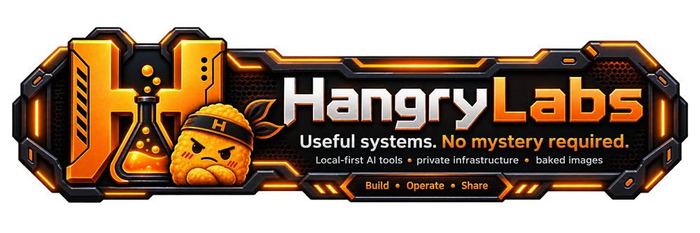
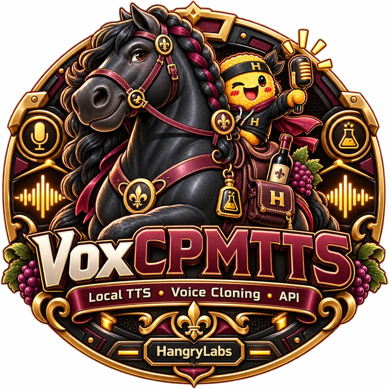
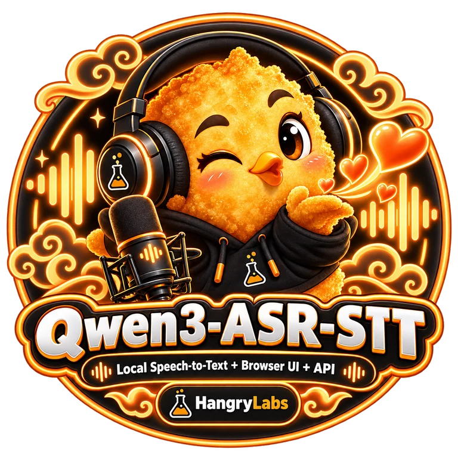
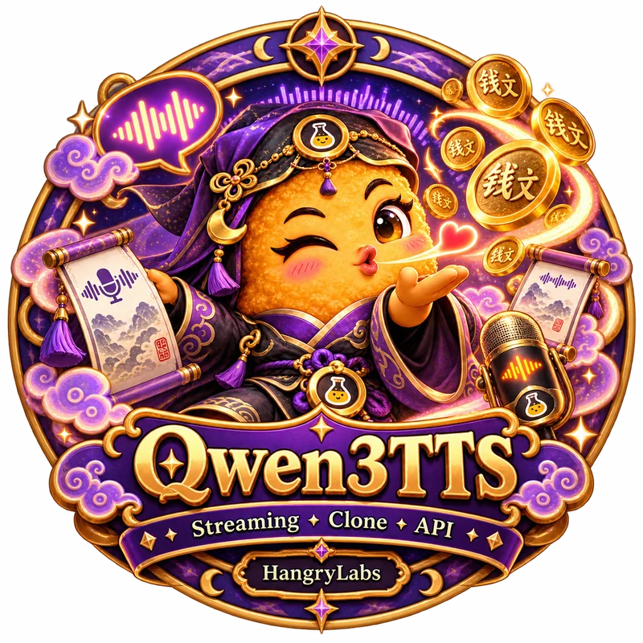

  

# Hi, I'm HangryNugget 👋

Gamer cursed by side quests. I just want features to exist, but somehow "one small fix" keeps stealing my gaming time.

I run [Hangry Labs](https://github.com/hangry-labs), where useful technical proofs of concept grow into finished, approachable tools that people can actually run.

## What I Build

- Local-first and self-hosted software
- Practical AI tools with browser interfaces and documented APIs
- Docker images that include the difficult parts
- Speech, creator, automation, and observability tools
- The occasional small utility that becomes an entire platform

I care about privacy, reproducible installations, honest technical limits, and software that keeps working after the exciting demo is over.

## Current Side Quests

  
  
  
   
  
  
  
  

Pick a side quest. Each badge opens its repository.

More projects live at [github.com/hangry-labs](https://github.com/hangry-labs).

## Find Me

- 🌐 [hangrylabs.app](https://hangrylabs.app/)
- 🧪 [Hangry Labs on GitHub](https://github.com/hangry-labs)

For humanity and the power of nuggets.
